<!-- The animated SVGs in assets/ are made by assets/make_assets.py. -->

<picture>
  <source media="(prefers-color-scheme: dark)" srcset="https://readme-typing-svg.demolab.com?font=Fira+Code&weight=500&size=18&duration=2800&pause=1200&color=D4AC0D&center=true&vCenter=true&width=620&lines=Starting+from+the+problem%2C+not+the+method;NLP%2C+graph+learning+and+explainable+ML;Mentor+to+15%2B+student+research+teams;Building+PaperPreflight%2C+a+pre-submission+checker">
  
</picture>

  

 

## About

I start from a real problem and follow it into whatever field the solution needs. So far that has meant fake news on social media, air quality in Dhaka, seismic imaging of the subsurface, and graphs that keep changing while you learn from them.

I am a CSE graduate of International Islamic University Chittagong (IIUC) with hands-on experience across the full research lifecycle: problem framing, experimental design, implementation, ablation studies and statistical validation. On the engineering side I build full-stack applications with Django, relational databases and clean interfaces.

I also enjoy helping others do research well. I have mentored 15+ student teams from literature review to finished manuscript, taught 280+ students as a Teaching Assistant, and review papers before submission for structure and reporting quality. That last habit is what led me to build [PaperPreflight](https://github.com/C221213-Maisha/PaperPreflight).

 

<picture>
  <source media="(prefers-color-scheme: dark)" srcset="assets/stats-dark.svg">
  
</picture>

  

## Problems I have worked on

<picture>
  <source media="(prefers-color-scheme: dark)" srcset="assets/fields-dark.svg">
  
</picture>

  

## Featured projects

<a href="https://github.com/C221213-Maisha/PaperPreflight">
  <picture>
    <source media="(prefers-color-scheme: dark)" srcset="assets/paperpreflight-dark.svg">
    
  </picture>
</a>

**PaperPreflight** reads a LaTeX, Word or PDF manuscript the way a careful reviewer would on a first pass. It checks the numbers in the abstract against the tables, every figure, table and citation reference, an ML reporting checklist, and venue format rules (IEEE, ACM, NeurIPS, ICML, ACL, Springer LNCS, Elsevier). For AI and ML papers it can also compare reported results with saved notebook outputs. Every issue points to the exact line, and the paper never leaves the browser.

 

<a href="https://github.com/C221213-Maisha/StudyDesk">
  <picture>
    <source media="(prefers-color-scheme: dark)" srcset="assets/studydesk-dark.svg">
    
  </picture>
</a>

**StudyDesk** is a web-based study management tool that helps students manage their schedules, assignments and deadlines in one place. Students log their weekly class schedule, organize notes and files into Drive-style folders with drag-and-drop upload, and track goals against due dates. Any uploaded PDF with a text layer can be turned into a 5-question multiple-choice quiz, generated through the Gemini API from that PDF's content alone and scored instantly. It also includes secure sign-up and login and a quick reference on study techniques.

 

## On GitHub

<picture>
  <source media="(prefers-color-scheme: dark)" srcset="generated/contributions-dark.svg">
  
</picture>

  

<picture>
  <source media="(prefers-color-scheme: dark)" srcset="generated/stats-dark.svg">
  
</picture>
<picture>
  <source media="(prefers-color-scheme: dark)" srcset="generated/languages-dark.svg">
  
</picture>

  

<picture>
  <source media="(prefers-color-scheme: dark)" srcset="generated/streak-dark.svg">
  
</picture>

  

<picture>
  <source media="(prefers-color-scheme: dark)" srcset="generated/activity-dark.svg">
  
</picture>

  

<picture>
  <source media="(prefers-color-scheme: dark)" srcset="generated/milestones-dark.svg">
  
</picture>

These cards are rebuilt every 6 hours by a GitHub Action in this repository.

 

## Research

### Publications

| Paper | Venue | Role | Highlights |
|---|---|---|---|
| [KNOW-NET: A Knowledge-Aware Cross-Attention Network with NER for Fake News Classification](https://doi.org/10.1109/QPAIN69676.2026.11546260) | IEEE QPAIN 2026 | Lead author | Dual-encoder transformer with knowledge-graph cross-attention. 0.9855 F1-score and accuracy on the Kaggle Fake News dataset, 1.41% absolute improvement over DEAP-FAKED (p < 0.0001), 15 ms/sample inference |
| [A Novel Association Rule Mining Approach Based on Bio-Inspired Algorithms for Air Quality Analysis in Dhaka, Bangladesh](https://doi.org/10.1109/QPAIN66474.2025.11172200) | IEEE QPAIN 2025 | Contributing author | Hybrid GA-PSO algorithm, 87% better memory efficiency than Apriori, mean confidence 0.936 vs 0.718 (p = 0.0002) |

Both papers are Scopus-indexed. Multiple manuscripts are accepted and under review.

### Presented work

**OFA-Seis: Optimized Fusion Attention with Physics-Guided Multi-Task Learning for High-Resolution and Explainable Seismic Inversion** 
Scholars' Convergence: Research & Innovation Summit 2026, CUSS, University of Chittagong. Sole author, manuscript in preparation.

An explainable, physics-guided deep learning framework that combines optimized cross-attention, multi-task learning and geophysical constraints to improve the accuracy and interpretability of seismic inversion for subsurface imaging.

### B.Sc. thesis

**NEXARIS: Imbalanced Multi-Label Node Classification on Evolving Graphs** 
IIUC, 2025 to 2026. Lead researcher, defended with A+.

A graph model for multi-label node classification under class imbalance and evolving graph structure. Benchmarked across four domains (social networks, citation networks, computational biology and financial transactions), it outperformed standard GCN baselines by 5 to 9 percentage points in Micro-F1 and Macro-F1, validated through a full statistical ablation study.

### Research mentoring

Mentored 15+ student teams end to end, from literature review through methodology design, implementation and manuscript writing, across medical imaging, NLP and computer networks. I also review papers before submission for guideline compliance, clarity, results that match the underlying experiments, and template fit.

 

## Experience

**AI Technical Lead (Project-Based), Contradox** 
Oct 2025 to present

Lead a team building AI systems for real-world use, coordinating research, backend and frontend work, and owning decisions on system architecture and model integration.

**Teaching Assistant, International Islamic University Chittagong** 
Feb 2025 to Aug 2026 · CSE and EEE departments · three consecutive terms

Taught 8 course sections (35+ students each, 280+ in total): Machine Learning and Data Mining Lab, Competitive Programming I, Computer Programming I and II Sessional, and Technical Writing and Presentation. Progressed from introductory programming labs to conducting the Machine Learning and Data Mining Lab under faculty supervision, and was re-appointed each term. Prepared course materials, set evaluation questions, assessed 170+ assignments, and mentored students on technical reports and presentations.

**Python (Django) Trainee, EDGE Project, Bangladesh Computer Council (ICT Division)** 
Aug 2024 to Dec 2024

Ranked among the top 5 trainees in the cohort and delivered a Django capstone application covering the ORM, forms, authentication and basic REST API endpoints.

 

## Selected projects

| Project | Description | Stack |
|---|---|---|
| [PaperPreflight](https://github.com/C221213-Maisha/PaperPreflight) | Private, rule-based pre-submission checker for LaTeX, Word and PDF research papers, with line-level issues, venue presets and a readiness score | JavaScript, Netlify |
| [StudyDesk](https://github.com/C221213-Maisha/StudyDesk) | Study management platform: class scheduling, material organization, progress tracking, and AI-generated quizzes via the Gemini API | Python, Django, SQLite |
| [Urban-Gardening-Assistant](https://github.com/C221213-Maisha/Urban-Gardening-Assistant) | AI web application with three specialized gardening chatbots built on a RAG pipeline, plus a Genetic Algorithm, CSP and Simulated Annealing for crop scheduling and pest control | Python, Django, RAG |
| [TSN-Simulation](https://github.com/C221213-Maisha/TSN-simulation) | Time-Sensitive Networking simulation in OMNeT++/INET, paired with a machine learning delay-prediction pipeline | C++, Python |
| [Online-Assignment-Plagiarism-Checker](https://github.com/C221213-Maisha/Online-Assignment-Plagiarism-Checker) | Self-hosted, web-based plagiarism detection tool that compares text submissions locally | PHP, MySQL, C++ |
| [Student-Course-Management-System](https://github.com/C221213-Maisha/Student-Course-Management-System) | Desktop application for student, course and score management with authentication, CRUD operations and SQL Server integration | C#, Windows Forms, SQL Server |
| [Advanced-Task-Scheduler](https://github.com/C221213-Maisha/Advanced-Task-Scheduler) | CPU scheduling simulator implementing FCFS, SJF, Priority and Round Robin | Python, Django |
| [Journey-Planner](https://github.com/C221213-Maisha/Journey-Planner) | Console route planner using Dijkstra's Algorithm and DFS over a graph-modeled map | C++ |

 

## Skills

<table>
<tr>
<td width="22%"><b>AI and ML</b></td>
<td>

</td>
</tr>
<tr>
<td><b>ML libraries</b></td>
<td>

</td>
</tr>
<tr>
<td><b>Languages</b></td>
<td>

</td>
</tr>
<tr>
<td><b>Web and data</b></td>
<td>

</td>
</tr>
<tr>
<td><b>Research and tools</b></td>
<td>

</td>
</tr>
</table>

 

## Recognition and service

- **Grand Finalist, The Infinity AI BuildFest** (top 100 of 600+ teams), CloudCamp Bangladesh and BRAC University, 2026
- **Best Performer, C++ Programming and Problem Solving Bootcamp**, Phitron, 2024
- **Data Annotator, IIUC Intra University Datathon 2026**: manually annotated 7,900+ image-text pairs for a disaster-related dataset within a 4 to 5 day window, as part of a twelve-member volunteer team. The dataset is public on [Mendeley Data](https://data.mendeley.com/datasets/yzjz55sy97/1). Certificate of Appreciation.
- **Volunteer, IIUC Intra University Datathon 2026**: supported event operations under IIUC CSE Fest 2026. Certificate of Appreciation.

<b>Certificates and training</b>

 

| Certificate | Issuer | Period |
|---|---|---|
| Teaching Assistant Certificate | Dept. of EEE, IIUC | Feb 2026 to Jul 2026 |
| Teaching Assistant Certificate | Dept. of CSE, IIUC | Aug 2025 to Jan 2026 |
| Teaching Assistant Certificate | Dept. of CSE, IIUC | Feb 2025 to Jul 2025 |
| Python (Django) Training | EDGE Project | 2024 |
| C++ Programming and Problem Solving Bootcamp, Best Performer | Phitron | 2024 |
| Front-End Development Bootcamp | Programming Hero | 2024 |

 

## Education

**B.Sc. in Computer Science and Engineering**, International Islamic University Chittagong 
Jan 2022 to Jul 2026 · CGPA 3.73/4.00 · graduated in the top 5% of the batch

**Languages:** English (professional), Bangla (native), Arabic (reading), Hindi and Urdu (basic conversation)

 

